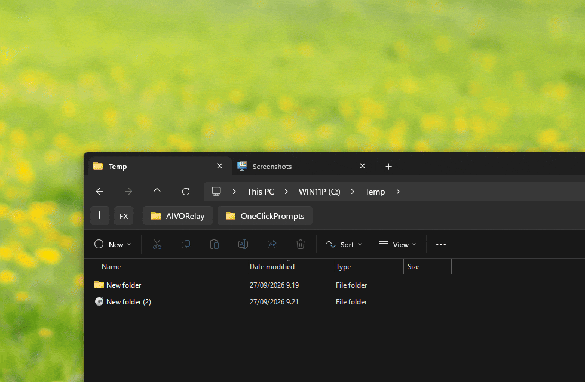

# Explorer Folder Bookmarks Bar

A [Windhawk](https://windhawk.net/) mod for Windows 11 File Explorer on x64 and ARM64. It puts folder bookmarks below the address bar, supports up to 32 folders, adapts from one to four rows, and scrolls horizontally when needed.

  

## Choose a version

| Version | Source | Status |
| --- | --- | --- |
| **0.7.8** | [Root source](explorer-folder-bookmarks-bar.wh.cpp) · [download source](https://github.com/MaxITService/EXPLORER-bookmarks-bar-windhawk/raw/main/explorer-folder-bookmarks-bar.wh.cpp) | Tested in File Explorer. In the Windhawk catalog since September 29, 2026 ([PR #5755](https://github.com/ramensoftware/windhawk-mods/pull/5755)). |
| **0.8.21** | [Development source](mods/explorer-folder-bookmarks-bar.wh.cpp) · [download source](https://github.com/MaxITService/EXPLORER-bookmarks-bar-windhawk/raw/main/mods/explorer-folder-bookmarks-bar.wh.cpp) | Source only, **untested** in File Explorer. New features are listed in the [changelog](CHANGELOG.md). |

The root file is the tested 0.7.8 release, unchanged. Development happens in `mods/`.

## Install

**From the Windhawk catalog:** Search Windhawk for **Explorer Folder Bookmarks Bar**, select the mod, and click **Install**. This installs **0.7.8**.

**From source:** Download either source linked above. In Windhawk, enable developer mode if **Create a new mod** is hidden, then create a mod or edit your existing `explorer-folder-bookmarks-bar` mod. Replace the entire `mod.wh.cpp` editor content with the source, click **Compile Mod**, and enable the mod. Version 0.8.21 is available only this way; compiling may take a while. Both files use the same mod ID, so only one can be active at a time.

After installing, enabling or updating the mod, open a new File Explorer window; windows already open may not get the bar.

## Use: 0.7.8 and newer

- Click **+** to bookmark the current folder. Click a bookmark to open it; Ctrl+click opens it in a new tab. Drag to reorder. Middle-click removes a bookmark; the folder itself is not touched. Hover shows the full path.
- Left-click **FX** for your profile folder, Desktop, Documents, Downloads and your own folders. Right-click **FX** for all drives. Ctrl+click a menu entry to open it in a new tab.
- Add your folders in Windhawk settings under **FX custom folders**: an absolute path (environment variables work) and an optional label. A missing local folder is hidden; network and removable folders are always listed. In 0.7.8, open a new window after changing settings; 0.8.21 updates open windows.
- Right-click **+** to save or load a bookmark backup (JSON).

## New since 0.7.8

Ctrl+B, dragging folders onto the bar, opening a bookmark in a new window, a notice when the bar is full, and optional recent folders. See the [changelog](CHANGELOG.md) for details.

## Other source variants

The [Double Decker source](explorer-folder-bookmarks-bar-double.wh.cpp) has two independent, horizontally scrollable bookmark rows. It is frozen at 0.7.8 and has not been tested in File Explorer. The [personal build](explorer-folder-bookmarks-bar-personal.wh.cpp) adds optional recent folders to Open and Save dialogs in all programs. It is frozen at 0.8.5, untested, loads into every process, and is not intended for the Windhawk catalog. All variants use the same mod ID; compile one at a time.

Licensed under [MIT](LICENSE).

## Other projects by MaxITService

- [AivoRelay](https://github.com/MaxITService/AIVORelay) — voice to text for Windows.
- [OneClickPrompts](https://github.com/MaxITService/OneClickPrompts) — prompt shortcuts for AI chats.
- [Console2Ai](https://github.com/MaxITService/Console2Ai) — send a PowerShell buffer to AI.
- [Ping-Plotter-PS51](https://github.com/MaxITService/Ping-Plotter-PS51) — a PowerShell ping plotter.
